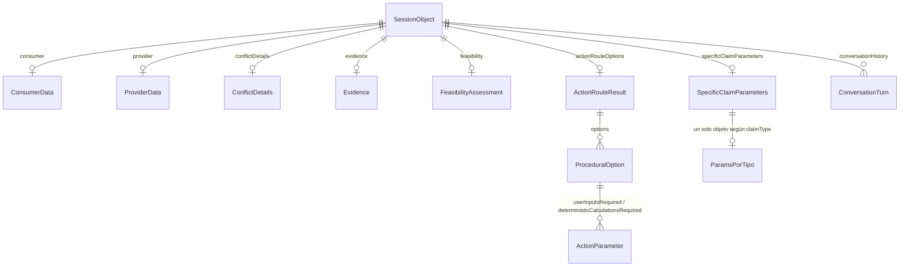

# Modelo de datos del reclamo (sesión)

Este documento describe el modelo de datos de un reclamo según el código: `SessionObject` (sesión viva en Redis) y la tabla `claim_case` (persistencia en PostgreSQL). La sesión se va completando capa por capa.

## 1. Visión general

| Almacén | Qué guarda | Ciclo de vida | Clase o tabla |
|---|---|---|---|
| **Redis** | La sesión en curso | Expira a las 24 h (`expiration = 86400`) | `SessionObject`, `@RedisHash("session")`, clave `session:<sessionId>` |
| **PostgreSQL** | El caso guardado, para consultarlo y retomarlo | Permanente | Tabla `claim_case` |

## 2. `SessionObject`

### 2.1 Metadatos de la sesión

| Campo | Tipo | Descripción |
|---|---|---|
| `sessionId` | String (`@Id`) | Identificador de la sesión. |
| `currentPhase` | `ClaimSessionState` | Estado macro del caso (secc. 4.1). |
| `expiration` | Long (`@TimeToLive`) | Segundos de vida en Redis. Por defecto 86400. |
| `createdAt`, `updatedAt` | LocalDateTime | Fechas de creación y última modificación. |

### 2.2 Capa 1 · Clasificación

| Campo | Tipo | Descripción |
|---|---|---|
| `claimType` | `ClaimType` | Tipo de reclamo principal (secc. 4.2). |
| `secondaryClaimType` | `ClaimType` | Tipo secundario, para reclamos mixtos. |
| `layer1State` | `Layer1InternalState` | Estado interno de la Capa 1. |
| `ragRetryCount` | Integer | Intentos de búsqueda RAG. El máximo es 3. |
| `currentSearchQuery` | String | Consulta jurídica que se envía a Qdrant. |
| `clarificationMessage` | String | Aclaración que se pide al usuario. |
| `applicableArticles` | List&lt;String&gt; | Artículos que fundamentaron la clasificación. |

### 2.3 Capa 2 · Parámetros

| Campo | Tipo | Descripción |
|---|---|---|
| `requiredParameters` | List&lt;String&gt; | Datos que la ley exige (de los metadatos `parametros_requeridos`). |
| `layer2State` | `Layer2InternalState` | Estado interno de la Capa 2. |
| `pendingParametersToAsk` | List&lt;String&gt; | Cola de datos por preguntar. |
| `currentParameterBeingAsked` | String | Dato que se está preguntando. |
| `currentQuestionForUser` | String | Pregunta redactada por el LLM. |
| `collectedParameters` | Map&lt;String, Object&gt; | Respuestas validadas, por nombre de parámetro. La Capa 4 las usa como fuente de datos. |
| `specificClaimParameters` | `SpecificClaimParameters` | Objeto estructurado final con los parámetros del tipo de reclamo (secc. 3). |
| `proceduralParameters` | List&lt;String&gt; | Parámetros del formulario procesal. |

### 2.4 Capa 3 · Razonamiento y procedimiento

| Campo | Tipo | Descripción |
|---|---|---|
| `layer3State` | `Layer3InternalState` | Estado interno de la Capa 3. |
| `viabilityReport` | String | Informe de viabilidad que ve el usuario. |
| `actionRouteText` | String | Texto del procedimiento legal. Alimenta la Capa 5. |
| `actionRouteOptions` | `ActionRouteResult` | Opciones procesales generadas (secc. 2.8). |
| `selectedOptionId` | String | Opción elegida por el usuario. |
| `proceduralArticles` | List&lt;String&gt; | Artículos procedimentales aplicables. |
| `proceduralFormData` | Map&lt;String, Object&gt; | Datos enviados desde el formulario procesal. |
| `executionPlan` | Map&lt;String, Object&gt; | Plan de ejecución. Incluye `base_article`, `action_title`, los datos del formulario y las variables por calcular. La Capa 4 reemplaza los valores `PENDIENTE_CALCULO`. |

### 2.5 Datos del conflicto (acumulativos)

| Campo | Tipo | Contenido |
|---|---|---|
| `consumer` | `ConsumerData` | `fullName`, `idCard`, `contactInfo`. |
| `provider` | `ProviderData` | `ruc`, `commercialName`, `address`. |
| `conflictDetails` | `ConflictDetails` | `description` (relato original), `eventDate` (LocalDate), `involvedAmount` (BigDecimal). |
| `evidence` | `Evidence` | Banderas booleanas de la evidencia (secc. 2.6). |
| `feasibility` | `FeasibilityAssessment` | `feasibilityLevel` (`ClaimFeasibility`), `reasoning`, `warnings`. |
| `missingQuestions` | List&lt;String&gt; | Preguntas pendientes. |
| `conversationHistory` | List&lt;`ConversationTurn`&gt; | Turnos con `role` (USER o ASSISTANT), `message` y `timestamp`. |

### 2.6 `Evidence`

Todos los campos son `boolean`, salvo `otherEvidenceDescription` (String). Indican si el usuario *tiene* la prueba; no se almacena el archivo.

| Grupo | Campos |
|---|---|
| Transacción (Art. 21) | `hasInvoice`, `hasPaymentReceipt`, `hasContract` |
| Producto o servicio | `hasWarrantyDocument`, `hasUserManual`, `hasEntryNote`, `hasPhotosOrVideos`, `hasBillingHistory` |
| Información y publicidad | `hasAdvertisingEvidence`, `hasPriceTagEvidence`, `hasLabelingEvidence` |
| Comunicación y reclamos | `hasWrittenCommunication`, `hasComplaintBookRecord`, `hasWitnesses` |
| Otros | `otherEvidenceDescription` |

### 2.7 `ConversationTurn` y `FeasibilityAssessment`

Se describen en la secc. 2.5. `ClaimFeasibility` toma los valores `ALTO`, `MEDIO` o `BAJO`.

### 2.8 Opciones procesales (Capa 3)

| Clase | Campos |
|---|---|
| `ActionRouteResult` | `options`: lista de `ProceduralOption`. |
| `ProceduralOption` | `optionId`, `title`, `description`, `basedOnArticle`, `userInputsRequired`, `deterministicCalculationsRequired`. |
| `ActionParameter` | `parameterName`, `isDeterministic`, `currentValue`, `questionForUser`, `parameterRole`. |

`userInputsRequired` lista lo que el usuario llena en el formulario. `deterministicCalculationsRequired` lista las variables que calcula la Capa 4.

## 3. `SpecificClaimParameters`

Contiene un campo por tipo de reclamo. **Solo se llena el del tipo activo**.

| Campo | Clase | Tipo de reclamo |
|---|---|---|
| `viciosOcultos` | `ViciosOcultosParams` | 1 · Vicios ocultos y calidad |
| `servicioTecnico` | `ServicioTecnicoParams` | 2 · Servicio técnico y custodia |
| `incumplimientoContrato` | `IncumplimientoContratoParams` | 3 · Incumplimiento, ofertas y mora |
| `informacionFacturacion` | `InformacionFacturacionParams` | 4 · Información, precios y facturación |
| `serviciosPublicos` | `ServiciosPublicosParams` | 5 · Servicios públicos domiciliarios |
| `contratos` | `Contratos` | 6 · Contratos de adhesión |
| `serviciosFinancieros` | `FinancierosCreditosCobranzasParams` | 7 · Financieros, créditos y cobranzas |
| `practicasAbusivas` | `PracticasAbusivasParams` | 8 · Prácticas abusivas de mercado |

Campos principales de cada clase. Las listas completas están en `org.app.schemas.session_object.Params`.

| Tipo | Campos principales |
|---|---|
| 1 | `productName`, `productBrand`, `productModel`, `purchaseDate`, `pricePaid`, `invoiceNumber`, `defectDescription`, `isUnfitForUse`, `wouldNotHaveBoughtIt`, `hasWarranty`, `warrantyDurationDays`, `warrantyProviderRefused`, `chosenRemedy`, `thirdPartyIntervention`; subobjeto `ViciosOcultosDeadlines` (plazos y viabilidad temporal, Art. 71) |
| 2 | `itemDescription`, `brand`, `model`, `entryDate`, `deliveryDate`, `repairDeliveryDate`, `repairCost`, `itemDeclaredValue`, `hasEntryNote`, `originalProblem`, `currentDefectDescription`, `custodyDamageDescription`, `providerRefusedToFix`, `providerRefusedIndemnification`, `claimsIndemnification`, `indemnificationEstimatedAmount`, más banderas sobre repuestos y eficacia del servicio |
| 3 | `agreementType`, `promisedGoodOrService`, `amountPaid`, `agreementDate`, `promisedDeliveryDate`, `breachDescription`, `requestedRemedy`, `isOfferOrPromotion`, `isServiceSuspension`, daños civiles y eventos; `dynamicParams` |
| 4 | `productOrServiceName`, `informationChannel`, `advertisedInfo`, `displayedPriceWithTaxes`, `chargedPrice`, subobjetos de rotulado de alimentos y medicamentos, bien durable, precio exhibido, factura, servicio profesional, telefonía (`TelefoniaBillingParams`) e intereses de mora (`InteresesMoraParams`) |
| 5 | `serviceType`, `supplyNumber`, `providerName`, banderas de calidad del servicio, subobjetos de seguros accesorios, registro de reclamos, seguridad, medición y facturación (`averageOfLastSixMonths`) e interrupción del servicio (`undevolvedAmount`); `dynamicParams` |
| 6 | `serviceType`, `providerName`, `contractStartDate`, `monthlyFee`, `wantsToTerminateEarly`, `notificationDate`, `penaltyAmount`, `penaltyIsIllegal`, deudas pendientes, pretensiones; `dynamicParams` |
| 7 | `financialProductType`, `providerName`, `totalCreditAmount`, `creditStartDate`, `totalInstallments`; subobjetos de información del crédito, pago anticipado, cobranza, pago con tarjeta y redondeo de intereses; `dynamicParams` |
| 8 | `productOrServiceName`, `providerName`, `eventDate`; subobjetos de venta condicionada, negativa de venta, envío no solicitado, vulnerabilidad, productos no certificados, reajuste ilegal, falta de plazo y redondeo de intereses |

Todos los tipos incluyen banderas de evidencia (`hasInvoice`, `hasPhotosOrVideos`, `hasWitnesses`, etc.) y `otherEvidenceDescription`.

## 4. Enumeraciones

### 4.1 `ClaimSessionState` (`currentPhase`)

| Capa | Estados |
|---|---|
| 1 | `INIT`, `TRIAGE_PROCESSING`, `LEGAL_GROUNDING`, `SUFFICIENCY_CHECK`, `GATHERING_MISSING_DATA` |
| 2 | `DETERMINING_PARAMETERS`, `DEADLINE_VALIDATION`, `DYNAMIC_PROMPTING`, `PARAMETER_VALIDATION` |
| 3 | `VIABILITY_EVALUATION`, `EVIDENCE_GAP_ANALYSIS`, `ACTION_SELECTION` |
| 4 | `ALGORITHMIC_PROCESSING` |
| 5 | `TEMPLATE_SELECTION`, `DOCUMENT_GENERATION`, `ESCALATION_GUIDANCE`, `COMPLETED` |

### 4.2 `ClaimType`

| Código | Valor | Nombre | Base legal |
|---|---|---|---|
| 1 | `VICIOS_OCULTOS_CALIDAD` | Bienes defectuosos y vicios ocultos | Arts. 20, 26, 71 |
| 2 | `SERVICIO_TECNICO_CUSTODIA` | Defectos en servicios técnicos y custodia | Arts. 22, 23, 24, 25, 73, 75 |
| 3 | `INCUMPLIMIENTO_CONTRATOS_MORA` | Incumplimiento de contratos, ofertas y mora | Arts. 18, 21, 30, 46, 55 (num. 7), 76, 77, 148 |
| 4 | `INFORMACION_PRECIOS_FACTURACION` | Información deficiente, precios y facturación | Arts. 6, 7, 8, 9, 12 a 17, 19, 21 (inc. 1), 27, 72, 91, 93 |
| 5 | `SERVICIOS_PUBLICOS_DOMICILIARIOS` | Servicios públicos domiciliarios | Arts. 32 a 40, 78 |
| 6 | `CONTRATOS` | Contratos de adhesión | Art. 44 |
| 7 | `FINANCIEROS_CREDITOS_COBRANZAS` | Servicios financieros, créditos y cobranzas | Arts. 47, 48, 49, 50, 55 (num. 8) |
| 8 | `PRACTICAS_ABUSIVAS_MERCADO` | Prácticas abusivas de mercado | Art. 55 |

### 4.3 Estados internos

| Enum | Valores |
|---|---|
| `Layer1InternalState` | `TRADUCIENDO_QUERY`, `BUSCANDO_FUENTES`, `EVALUANDO_PRECISION`, `CLASIFICACION_POR_METADATA`, `DONE`, `SOLICITANDO_ACLARACION`, `ERROR` |
| `Layer2InternalState` | `PRE_POPULATING_PARAMETERS`, `DETERMINING_PARAMETERS`, `GENERATING_QUESTIONS`, `WAITING_FOR_USER`, `VALIDATING_INPUT`, `DONE`, `SOLICITANDO_ACLARACION`, `ERROR` |
| `Layer3InternalState` | `VALIDATING_DPE_REQUIREMENTS`, `BLOCKED_DPE_REQUIREMENTS`, `EVALUATING_VIABILITY`, `PRESENTING_REPORT`, `WAITING_FOR_DECISION`, `BATCH_VALIDATING`, `GENERATING_ACTION_ROUTE`, `WAITING_FOR_ACTION_SELECTION`, `VALIDATING_PROCEDURAL_INPUT`, `WAITING_FOR_PROCEDURAL_INPUT`, `FINALIZING_PROCEDURE`, `DONE`, `ERROR` |
| `ClaimFeasibility` | `ALTO`, `MEDIO`, `BAJO` |

## 5. Persistencia en PostgreSQL: tabla `claim_case`

La tabla se crea al arrancar (`CREATE TABLE IF NOT EXISTS`). Cada caso es una fila. Guardar de nuevo la misma sesión actualiza la fila (`ON CONFLICT (id) DO UPDATE`). Los datos de búsqueda frecuente están en columnas simples; el resto, en columnas JSONB. `session_snapshot` conserva la sesión completa.

| Columna | Tipo | Origen en `SessionObject` |
|---|---|---|
| `id` | VARCHAR(64), PK | `sessionId` |
| `consumer_id_card` | VARCHAR(13), NOT NULL | `consumer.idCard` |
| `consumer_name`, `consumer_contact` | VARCHAR(200) | `consumer.fullName`, `consumer.contactInfo` |
| `provider_name` | VARCHAR(200) | `provider.commercialName` |
| `provider_ruc` | VARCHAR(13) | `provider.ruc` |
| `claim_type`, `secondary_type` | VARCHAR(60) | `claimType`, `secondaryClaimType` |
| `current_phase` | VARCHAR(60) | `currentPhase` |
| `feasibility_level` | VARCHAR(20) | `feasibility.feasibilityLevel` |
| `event_date` | DATE | `conflictDetails.eventDate` |
| `involved_amount` | NUMERIC(12,2) | `conflictDetails.involvedAmount` |
| `selected_option` | VARCHAR(100) | `selectedOptionId` |
| `summary` | TEXT | Resumen del caso |
| `consumer`, `provider`, `conflict_details`, `evidence` | JSONB | Los objetos del mismo nombre |
| `collected_params` | JSONB | `collectedParameters` |
| `specific_params` | JSONB | `specificClaimParameters` |
| `layer_states` | JSONB | `layer1State`, `layer2State`, `layer3State`, `ragRetryCount`, `clarificationMessage` |
| `legal_analysis` | JSONB | `applicableArticles`, `requiredParameters`, `viabilityReport`, `feasibility` |
| `action_route` | JSONB | `actionRouteText`, `actionRouteOptions`, `selectedOptionId`, `proceduralArticles`, `proceduralParameters` |
| `procedural_form` | JSONB | `proceduralFormData` |
| `execution_plan` | JSONB | `executionPlan` |
| `conversation` | JSONB | `conversationHistory` |
| `session_snapshot` | JSONB, NOT NULL | La sesión completa |
| `schema_version` | INT, NOT NULL | Versión del esquema (hoy 1) |
| `created_at`, `updated_at` | TIMESTAMPTZ | Fechas de creación y actualización |

**Índices:** `idx_claim_case_id_card` (`consumer_id_card`), `idx_claim_case_type_phase` (`claim_type`, `current_phase`) e `idx_claim_case_evidence` (GIN sobre `evidence`).

## 6. Observaciones

- Los datos personales (nombre, cédula, contacto) se guardan sin anonimizar en Redis y en PostgreSQL.
- `evidence` solo guarda banderas. No se almacena el archivo de la prueba.
- `session_snapshot` duplica la información de las demás columnas; permite reconstruir la sesión y retomar el caso.
- Las fechas se tipan como `LocalDate` en la sesión. La Capa 4 devuelve las fechas calculadas como texto `dd/MM/yyyy` en `executionPlan`.
